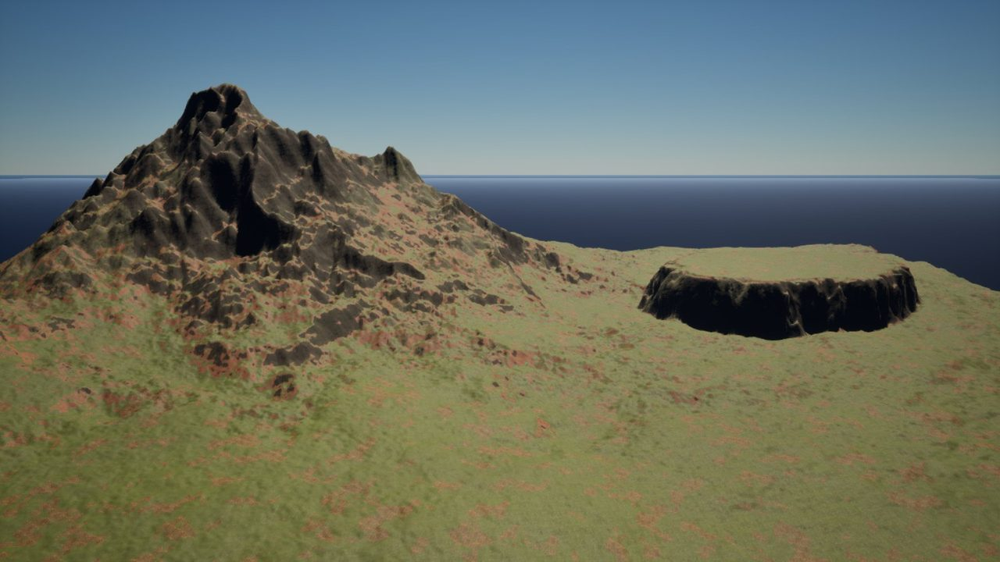
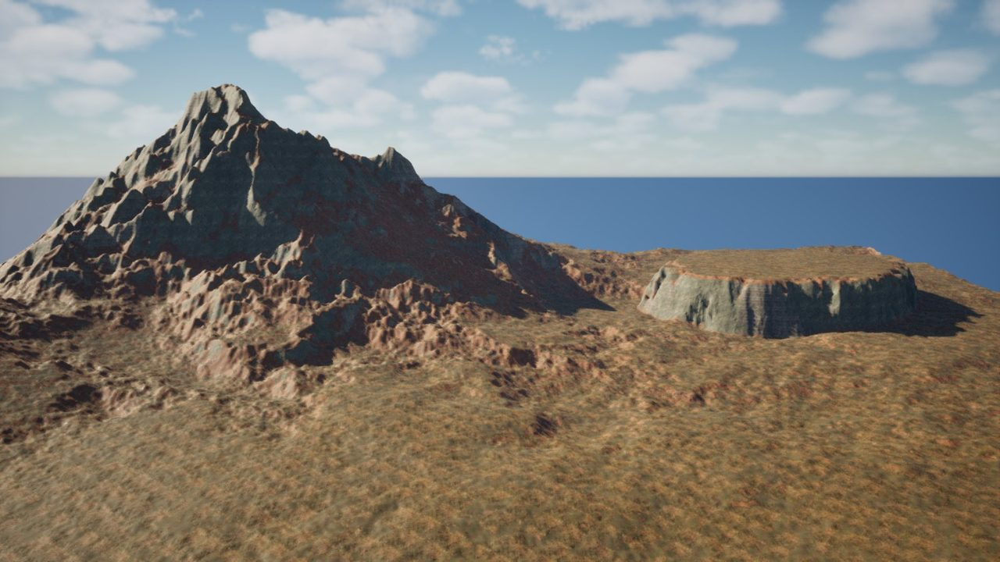
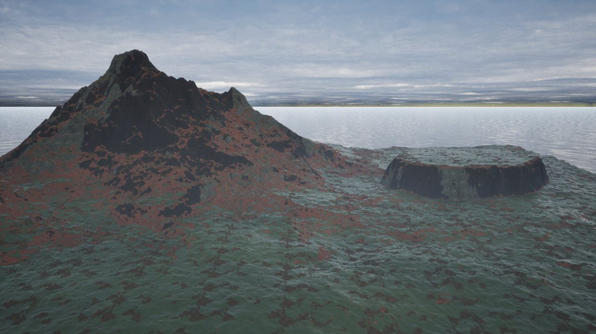
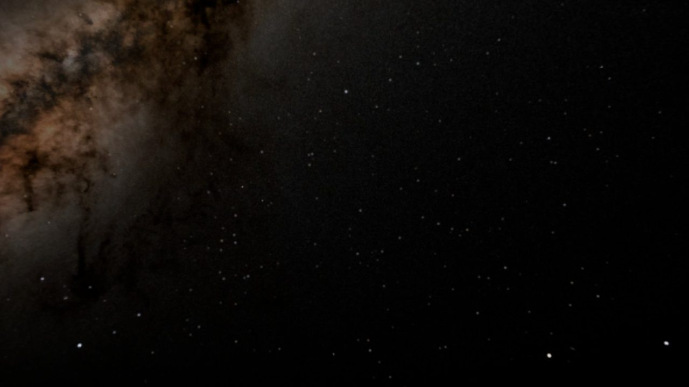
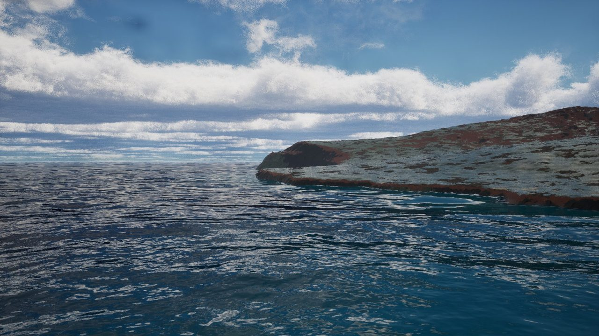
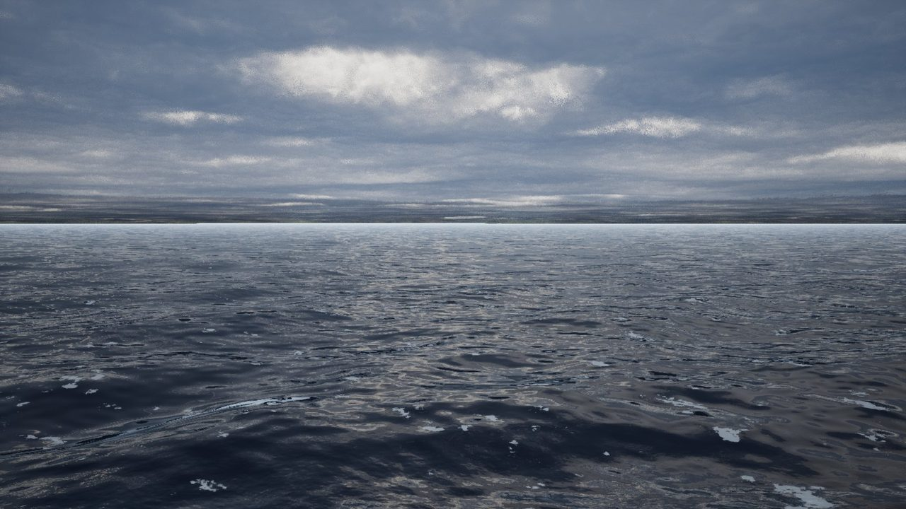
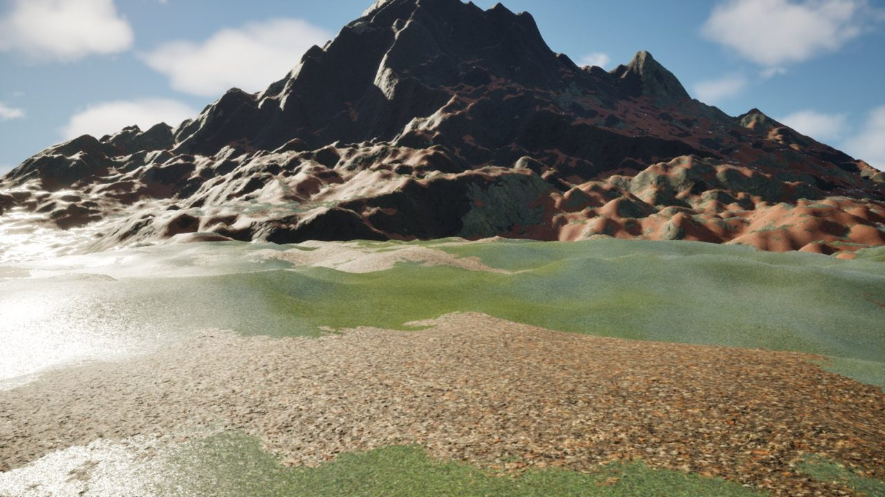
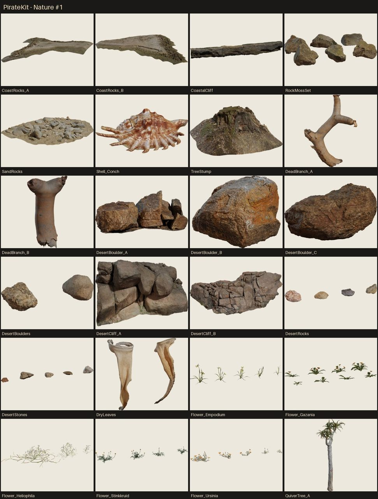

# Biome Environment Kit for Unreal Engine 5

A complete, realistic outdoor environment for UE5, in one plugin:

- **23 biome auto-materials**: paint-free, physically calibrated landscape materials from tropical islands to glaciers,
  deserts, swamps, volcanic fields, and the Moon and Mars. Assign `MI_Biome_<Name>` to a landscape, set the sea level,
  and the terrain textures itself from height, slope and noise. ([Docs/Biomes.md](Docs/Biomes.md))
- **A physical sky** (`BiomeSkyEnvironment`): the sun and moon where they really stand for any latitude, date and time,
  135 real stars and NASA's Milky Way turning about the pole, moon phases, meteors, auroras, volumetric clouds and fog
  driven by weather presets, rain and snow, lightning, and an exposure floor for dark nights. ([Docs/Sky.md](Docs/Sky.md))
- **An ocean** (`BiomeOcean`): Gerstner swells plus an FFT wind sea (JONSWAP spectrum) grown from the wind, whitecaps,
  surf that breaks on your own coast, depth-coloured water, and CPU water-height queries that match the GPU for
  buoyancy. ([Docs/Ocean.md](Docs/Ocean.md))
- **Marine life**: 104 procedural corals, sponges, sea grass, kelp, reef fish, sharks, rays, turtles, dolphins,
  whales and jellyfish. Plants sway in the surge and fish swim by vertex animation (no skeletons), shoals circle the
  reef, and the view turns into water when the camera dips under the waves. ([Docs/Marine.md](Docs/Marine.md))
- **Island assets** (three separate downloads): 261 Nanite meshes from the Polyester Pirates kit (trees and plants for every
  climate, rocks and cliffs, buildings, docks, a medieval town and castle, props) with per-biome scatter lists.
  ([Docs/Assets.md](Docs/Assets.md))

## Visual showcase

Browse the [full image gallery](Showcase/README.md) for verified Unreal captures of the island terrain, tropical materials, clouds, Milky Way night sky, aurora, ocean and asset library.

| Island terrain | Rainforest biome |
|---|---|
|  |  |

| Volumetric clouds | Milky Way night sky |
|---|---|
|  |  |

| Ocean shoreline | Stormy sea |
|---|---|
|  |  |

| Terrain material close-up | Island assets |
|---|---|
|  |  |

**Everything is free to use, change and ship, commercially too.** Code, shaders and tools are MIT. Photographic
textures and scanned assets are CC0 (Poly Haven, ambientCG); the moon and Milky Way maps are NASA imagery (public
domain); the kit's own generated assets are released under CC0. See [CREDITS.md](CREDITS.md) and
[Docs/AssetCredits.md](Docs/AssetCredits.md).

## Quick start

1. Download `BiomeEnvironmentKit-<version>-UE<engine>.zip` and all three `...-Textures-...zip` files from Releases.
   The textures are required by the materials. To install the island assets too, download all three
   `...-IslandAssets-...zip` files. Unzip the selected files into `<YourProject>/Plugins/`, so you get
   `Plugins/BiomeAutoMaterials/BiomeAutoMaterials.uplugin`.
2. Open the project (prebuilt Win64 binaries are included; C++ projects rebuild the two small modules themselves).
3. Open `Showcase/L_BiomeShowcase` from the plugin's content to see everything together, or in your own level:
   - delete the default sun, sky atmosphere, sky light, fog and clouds, then place **Biome Sky Environment**;
   - place **Biome Ocean** at your sea level and press **Bake Shore Field**;
   - set your landscape's material to `Biomes/MI_Biome_<Name>`.

## Biome material features

- **One master, 23 biomes.** Every biome is a material instance of `M_BiomeAuto`. Static switches stay the same across
  instances, so swapping biomes never recompiles shaders.
- **Eight-layer stack:** Ground → GroundB (patches) → Soil (banks, bare patches) → Shore (beach at sea level) → Scree
  (talus at the angle of repose) → Rock A/B (triplanar cliffs) → Snow → water (wet band, rain, puddles).
- **Height-based blending.** The layers blend by their real displacement maps, so pebbles poke out of sand, sand fills
  the gaps between stones, and snow fills hollows first.
- **Hex-tiling anti-repetition** (Mikkelsen 2022): ground layers use three randomly rotated tiles blended along the
  texture's own height. A larger, rotated far copy fades in with distance, and macro brightness and saturation drift on
  top. You won't see tiling, near or far.
- **Real-world scale.** Each texture's repeat size comes from the measured dimensions Poly Haven publishes for it, so a
  pebble keeps the same size in every biome.
- **Albedo calibration.** At build time each set's mean albedo is measured and adjusted to a literature value (fresh snow
  ≈ 0.85, desert sand ≈ 0.40, green grass ≈ 0.09, basalt ≈ 0.06). Biomes look right side by side under the same sun and
  exposure.
- **Triplanar cliffs** with orientation-corrected normals, two rock types mixed by noise or by **sedimentary strata**
  (warped horizontal bands with per-band tint, for canyons and badlands), and moss on up-facing rock.
- **Snow that reads the relief.** Snow is decided on the detailed normal, so it stays on ledges and stone tops and falls
  off steep faces. You control the ragged snow line and the winter cover below it.
- **Water.** Porous layers darken and turn glossy above the sea line and in rain, and puddles collect in flat hollows.
- **Cheap where it can be.** Every layer is in a dynamic branch, and a layer that is completely covered by one above is
  never sampled. All 17 textures share the view's wrap sampler, so the 16-sampler limit doesn't apply. Material Quality
  Low turns hex-tiling off.
- **Debug view.** Set `Debug View` to 1 to colour each layer's coverage.

## Biomes

| | | | |
|---|---|---|---|
| TropicalIsland | Rainforest | Swamp | TemperateMeadow |
| TemperateForest | AutumnForest | BorealTaiga | Alpine |
| ArcticTundra | Glacier | DesertDunes | RockyDesert |
| RedCanyon | Savanna | Steppe | Mediterranean |
| Volcanic | RockyCoast | Moorland | SaltFlat |
| BurnedForest | Lunar | Martian | |

Screenshots and the texture sets behind each biome are in [Docs/Biomes.md](Docs/Biomes.md). Every parameter is
described in [Docs/Parameters.md](Docs/Parameters.md).

## Install (release zip)

1. Download `BiomeEnvironmentKit-<version>-UE<engine>.zip` and all three `...-Textures-...zip` files from Releases.
2. Unzip all four into `<YourProject>/Plugins/`, so you get `<YourProject>/Plugins/BiomeAutoMaterials/BiomeAutoMaterials.uplugin`.
3. Open the project. In the Content Browser, enable *Show Plugin Content* and open `BiomeAutoMaterials Content`.
4. Select your landscape and set **Landscape Material** to `Biomes/MI_Biome_<Name>`.
5. In the instance, set:
   - `Sea Level`: world Z of your water, in metres.
   - `Landscape Quad Size`: your landscape's X/Y scale ÷ 100. The default scale of 100 means 1 m quads.
   - `Snow Line`: in metres above sea level.
6. Optionally, open `Showcase/L_BiomeShowcase` to try every biome on the test terrain.

The material also works on meshes, such as Nanite terrain or voxel meshes. Enable `Use World Coordinates`.

## Build from source

The repository holds only the tools. You build the textures and assets yourself:

```bash
pip install numpy pillow
python Tools/fetch_textures.py --res 2k        # downloads ~1.7 GB of CC0 sets once, packs them into Build/
```

Then copy or clone the repository into `<YourProject>/Plugins/BiomeAutoMaterials` and run the builder in the editor
(*Tools > Execute Python Script*, with the Python Editor Script Plugin enabled), or from the command line:

```bash
UnrealEditor-Cmd.exe <Project>.uproject -ExecutePythonScript="<Project>/Plugins/BiomeAutoMaterials/Tools/build_materials.py" -unattended
```

The sky, ocean and island assets build the same way:

```bash
python Tools/sky/fetch_sky_textures.py                       # NASA maps (public domain)
python Tools/assets/prepare_glb.py --kit <path to the Polyester Pirates kit>
python Tools/marine/marine_life.py && python Tools/marine/marine_fauna.py   # procedural sea life
set BAM_RUN=sky/build_sky_assets.py,ocean/build_ocean_assets.py,marine/build_marine_assets.py,assets/import_assets.py
UnrealEditor-Cmd.exe <Project>.uproject -ExecutePythonScript="<Project>/Plugins/BiomeAutoMaterials/Tools/run_many.py" -unattended
```

`Tools/build_showcase.py` then builds the showcase level (`BAM_SHOTS=all` also photographs it).

| Tool | What it does |
|---|---|
| `Tools/biomes.py` | The data: texture library (source, target albedo, porosity), slot layout and biome presets. Edit this to add a biome. |
| `Tools/fetch_textures.py` | Downloads the sets and packs them: `CH` = colour + height, `NRA` = normal XY + roughness + AO. Measures albedo, generates the tileable noise, and writes CREDITS.md. `--res 1k/2k/4k`. |
| `Tools/build_materials.py` | Runs in the editor. Imports textures (BC7), generates the master graph from `Tools/hlsl/*.hlsl`, and creates the calibrated biome instances. |
| `Tools/make_showcase_terrain.py` | Generates the 1 km test terrain and its review cameras. |
| `Tools/build_showcase.py` | Runs in the editor. Builds the showcase level and, with `BAM_SHOTS=1`, photographs every biome. |
| `Tools/make_docs.py` | Writes Docs/Biomes.md, Docs/Parameters.md and the gallery from the data and the shots. |
| `Tools/sky/fetch_sky_textures.py` | Downloads NASA's moon and Milky Way maps and packs them into `Build/Sky`. |
| `Tools/sky/build_sky_assets.py` | Runs in the editor. Builds `M_BiomeSky`, `M_BiomeClouds`, `M_BiomePrecipitation` and `MPC_BiomeSky`. |
| `Tools/ocean/build_ocean_assets.py` | Runs in the editor. Builds the `M_BiomeOcean` water material from `Tools/ocean/hlsl`. |
| `Tools/assets/catalog.py` | Licence audit of the island assets and the per-biome scatter lists. |
| `Tools/assets/prepare_glb.py` | Shrinks the kit's `.glb` textures for release into `Build/Assets`. |
| `Tools/marine/marine_life.py`, `marine_fauna.py` | Generate the 104 sea creatures and plants (numpy only) into `Build/Marine`. |
| `Tools/marine/build_marine_assets.py` | Runs in the editor. Builds `M_SeaLife`, `M_SeaCreature`, `M_SeaJelly` and imports the marine meshes into `/BiomeAutoMaterials/Marine`. |
| `Tools/assets/review_assets.py` | Runs in the editor. Photographs every imported asset and creature, 12 to a frame, for review. |
| `Tools/assets/import_assets.py` | Runs in the editor. Imports the island assets (Nanite, collision) into `/BiomeAutoMaterials/Assets`. |
| `Tools/assets/scatter_biome.py` | Runs in the editor. Scatters a biome's trees, plants and rocks over the open level's landscape. |
| `Tools/run_many.py` | Runs several of the editor scripts in one session (`BAM_RUN=a.py,b.py`). |
| `Tools/package_release.py` | Zips the built plugin (and the island assets separately) for a GitHub release. |

### Adding a biome

Add an entry to `BIOMES` in `Tools/biomes.py`. It maps slots to texture keys, plus parameter overrides and tints.
If it needs a new texture, add it to `TEXTURES` with its Poly Haven (`ph:<id>`) or ambientCG (`acg:<id>`) source and
a target albedo. Then rerun `fetch_textures.py` and `build_materials.py`.

## Performance notes

- Pixel cost depends on how many layers overlap. Flat ground or bare cliff costs 1–2 layers. A snowy talus edge can
  reach 5.
- Hex-tiling triples the ground texture reads. To trade quality for speed, set `Hex Tiling` to 0 or use material
  quality Low.
- 2K textures in BC7 take about 5.3 MB each, including mips. A biome uses 16, and textures shared between biomes
  are stored once.

## Requirements

- Unreal Engine 5.x. The release assets are saved with the engine named in the zip. Building from source works on any
  UE5 with the Python Editor Script Plugin.
- Lumen and Nanite aren't required for the biome materials (they write a world-space normal). The island assets are
  Nanite meshes, and the sky and ocean are tuned for Lumen, Virtual Shadow Maps and the default (non-physical) light units.
- The `BiomeSky` and `BiomeOcean` C++ modules depend only on Core, CoreUObject, Engine, RenderCore, RHI and the mesh
  description modules. Prebuilt binaries are Win64; other platforms compile them from `Source/`.

## License

Code, HLSL, material graphs and tools: MIT ([LICENSE](LICENSE)). Textures and scanned assets: CC0, from Poly Haven and
ambientCG ([CREDITS.md](CREDITS.md), [Docs/AssetCredits.md](Docs/AssetCredits.md)). The kit's own generated island
assets: CC0. Moon and Milky Way maps: NASA (public domain; credit NASA SVS and ESA/Gaia/DPAC, see [Docs/Sky.md](Docs/Sky.md)).
The cloud shapes use the engine's own volume noise textures, referenced from `/Engine`, not redistributed.
