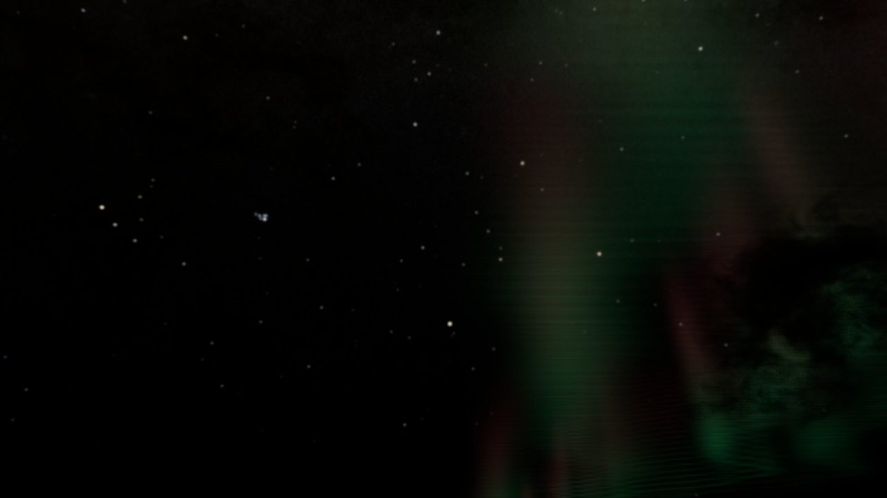

# Visual showcase

Selected Unreal Engine captures from the Biome Environment Kit. The images are compact previews; open an image for its full resolution.

### Tropical island terrain

### Volumetric cloud cover

### Wind-driven ocean and shoreline

### Night sky and aurora

### Island asset library

The camera positions used for the showcase terrain are in [`cameras.json`](cameras.json).
