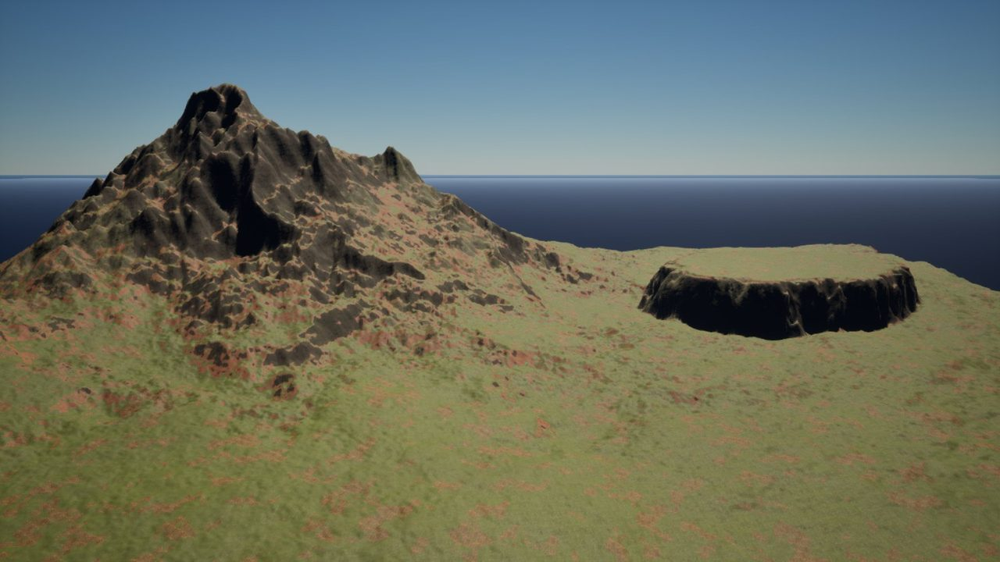
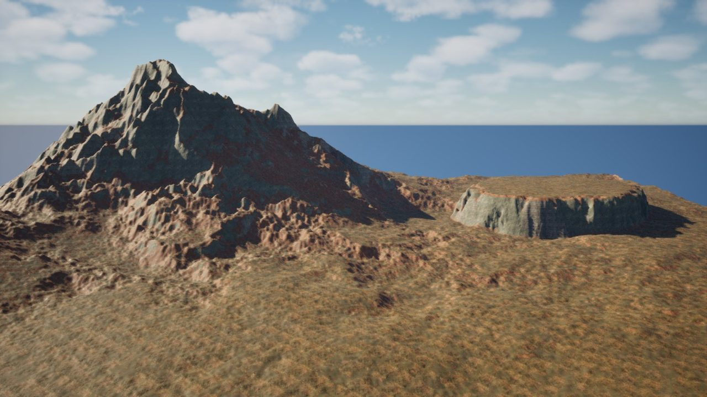
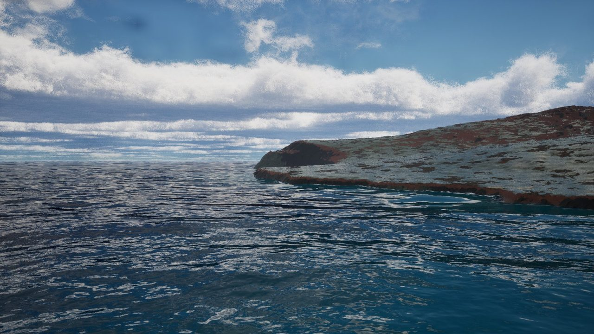
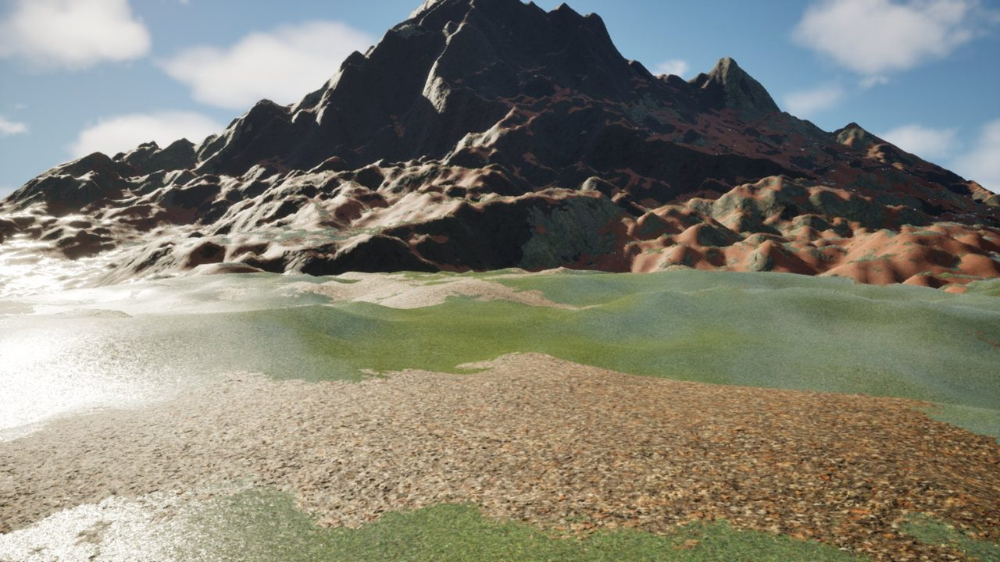
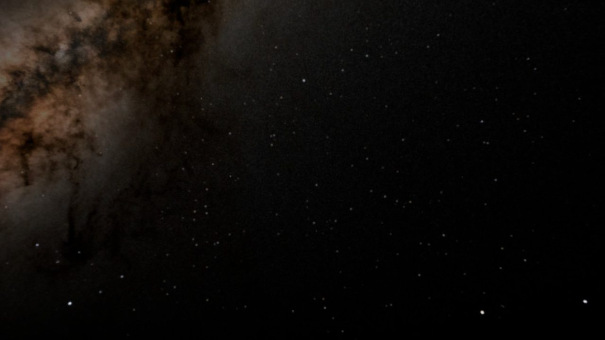
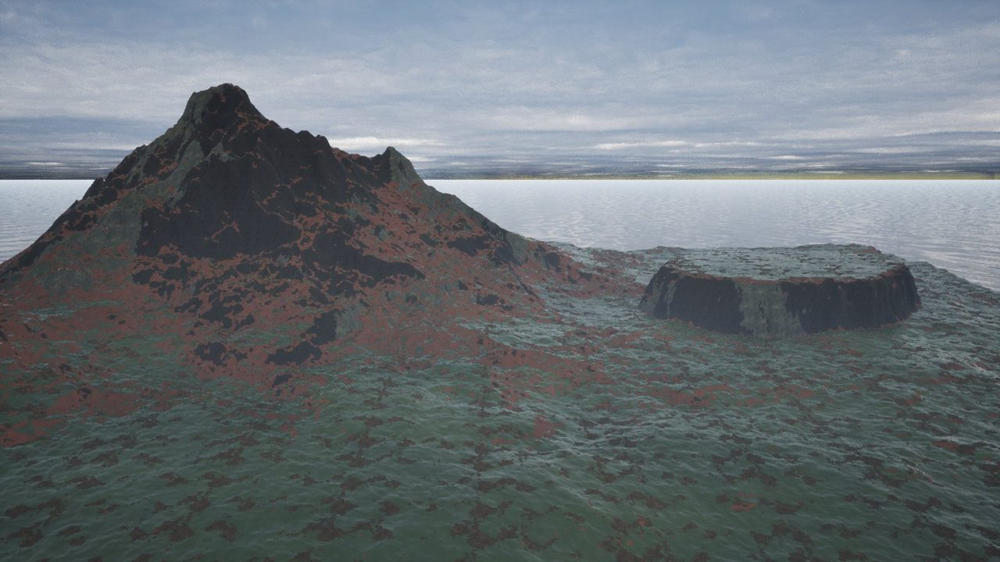
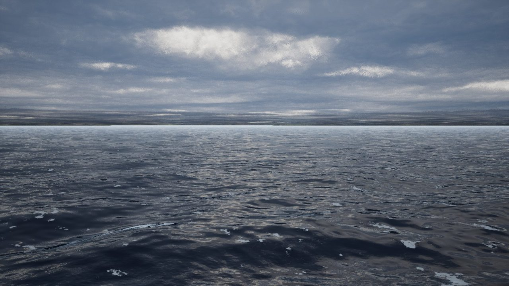
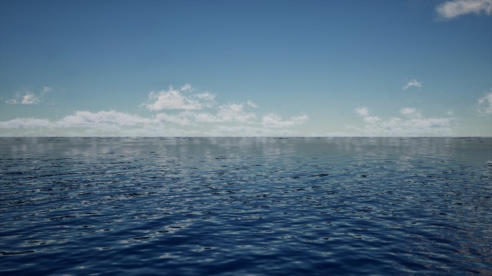
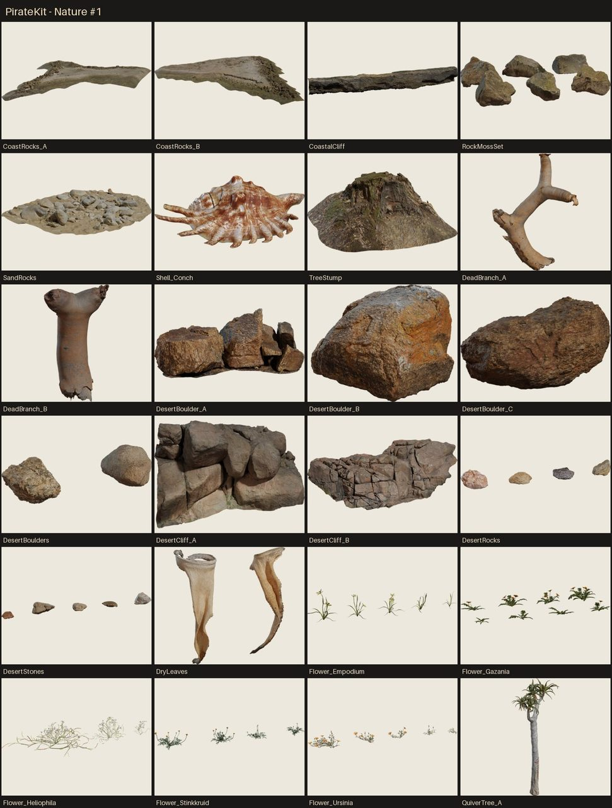

# Visual showcase

Real-time Unreal Engine captures from the Biome Environment Kit. Select any image to view the full-resolution render.

## Island landscapes

| Tropical island | Rainforest coast |
|---|---|
|  |  |

| Shore materials | Terrain materials close-up |
|---|---|
|  |  |

## Sky and weather

| Milky Way at night | Volumetric cloud ceiling |
|---|---|
|  |  |

| Aurora sky | Stormy sea |
|---|---|
|  |  |

## Ocean and assets

| Calm open water | Island assets |
|---|---|
|  |  |

The camera positions used for the showcase terrain are in [`cameras.json`](cameras.json). The gallery contains verified Unreal captures; no generated or placeholder frames are presented as engine output.
